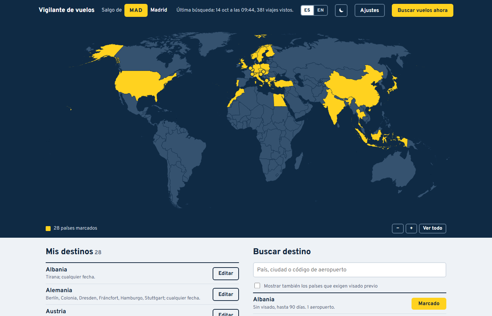
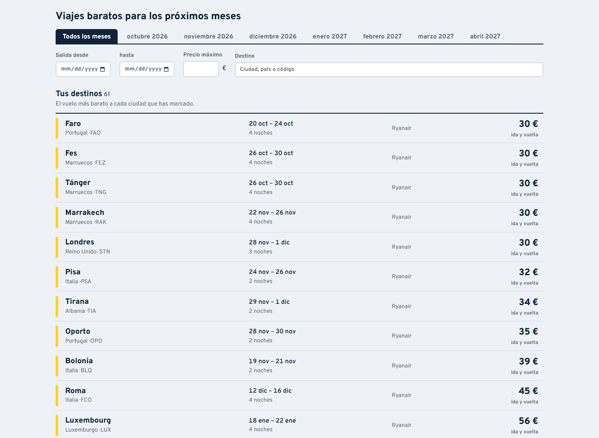
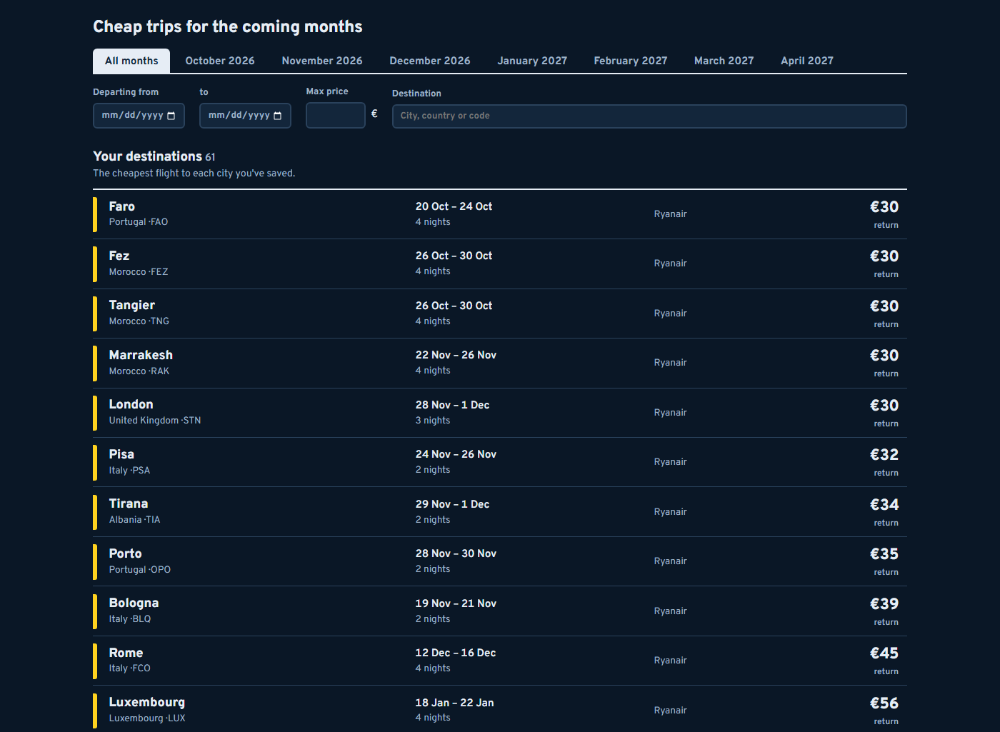

# flight-watcher

A personal flight-price watcher that checks fares once a day and only notifies you when a trip is actually worth it.

[](https://github.com/AketzaBarajas/flight-watcher/actions/workflows/ci.yml)
[](LICENSE)



## Overview

Price-alert tools either spam you every day or only watch one fixed route. flight-watcher does two jobs. It watches **exact routes** (a leg and specific dates, from `config.yaml`), and it runs a **destination agent**: you mark countries, cities and dates in a local panel, and it prioritises those, while anything you did not mark is only reported when it is a real bargain. It runs as a scheduled task on Windows and pushes alerts to your phone through [ntfy](https://ntfy.sh).

The panel can be switched between Spanish and English; the alerts and the code comments are in Spanish. A detailed Spanish user guide lives in [docs/guia-de-uso.md](docs/guia-de-uso.md).

## Features

- **Exact routes:** for each leg in `config.yaml`, alerts when the best price (with your filters: stops, duration) drops under your maximum or 15 % below its recent average.
- **Destination agent:** a rule-based loop (plan → query → remember → decide → act) that explores Ryanair's network from your airport and checks specific cities on Google Flights, within a daily query budget.
- **Anti-noise rules:** "usual price" is the median of the daily best price per destination and month; an alert is not repeated unless the price improves 10 % or three weeks pass; at most 6 alerts for saved destinations and 3 for the rest per message.
- **Local panel:** world map, saved destinations, and search across 233 countries and territories with 4,008 airports that have scheduled service.
- **Cheapest trip per saved city:** every city you marked is always listed with its cheapest flight. You can view one month or all of them, and filter by departure date, price and destination. Google queries are spent on the saved city-and-month pairs that Ryanair does not cover, those without a price for longest first, so every pair gets a price within about two weeks. When today's search has no price for a city, the panel shows the last one seen, with its date. Cheap places you did not mark are listed separately.
- **Spanish or English, light or dark:** the panel switches language and theme from the top bar. It starts with the system theme and remembers your choice.
- **Entry requirements:** each country shows the entry requirement for a Spanish passport; countries that need a visa in advance are hidden unless you ask for them.
- **Runs unattended:** a Windows scheduled task fires hourly from 08:00, but only the first successful run of the day queries prices, so it still works if the PC was off in the morning.





## Tech stack

| Layer | Technology |
| ----- | ---------- |
| Core | Python 3.13, PyYAML |
| Price sources | Google Flights results page (custom parser on top of `fast-flights` 3.1.0), Ryanair's fare-finder endpoint |
| Panel | Standard-library `http.server`, vanilla JS, D3 7.9 + topojson-client (served locally) |
| Tray icon | pystray + Pillow |
| Alerts | ntfy push; Gmail SMTP (written, untested) |
| Scheduling | Windows Task Scheduler (PowerShell script) |
| Tests / CI | pytest, GitHub Actions |

## Getting started

Requires Python 3.13 on Windows. The core and the tests also run on Linux; the tray icon and the scheduler script are Windows-only.

```powershell
git clone https://github.com/AketzaBarajas/flight-watcher.git
cd flight-watcher
python -m venv .venv
.venv\Scripts\python -m pip install -r requirements.txt pytest
copy .env.example .env                 # set NTFY_TOPIC (the topic name acts as a password)
copy config.example.yaml config.yaml   # put your own routes and dates
.venv\Scripts\python -m vigilante --dry-run   # show what it would do today, without saving or alerting
```

Then:

```powershell
.venv\Scripts\python -m vigilante --probar-aviso                            # send a test alert
.venv\Scripts\python -m vigilante.panel.servidor                            # panel at http://127.0.0.1:8765
powershell -ExecutionPolicy Bypass -File scripts\programar_windows.ps1      # schedule the daily run
powershell -ExecutionPolicy Bypass -File scripts\arranque_con_windows.ps1   # tray icon at login
```

`data/` (saved destinations, price history, run log) is created on the first run and is never committed.

## Testing

```powershell
.venv\Scripts\python -m pytest
```

71 tests as of 2026-10-14, covering the alert rules, the Google Flights parser (against a saved response in `tests/fixtures/`), the agent's planning and decisions, the panel server's API and local-only checks, and an end-to-end run with the sources mocked. They run on every push in CI.

## Architecture

```text
vigilante/
  __main__.py         exact routes, then the agent
  agente.py           plan · query · remember · decide · act
  reglas.py           alert rules for exact routes
  historico.py        price history and alert state (CSV/JSON in data/)
  intereses.py        saved destinations from the panel, validated
  catalogo.py         countries, cities and airports
  avisos.py           ntfy / email / console
  fuentes/            google_flights.py · ryanair.py
  panel/              servidor.py, static/ (HTML, CSS, JS, map, font), datos/catalogo.json
  bandeja.py          tray icon
scripts/              Task Scheduler setup, catalogue builder
tests/
```

- **Rules, not an LLM.** Deciding whether a price is worth an alert is arithmetic over a price history. A rule-based loop is predictable, free to run daily and easy to test.
- **Ryanair for "anywhere", Google for specific cities.** Ryanair's fare finder returns the cheapest round trip to every destination in one call; Google Flights covers any airline but only one city and date per query. No free source was found that does "anywhere" for all airlines.
- **Plain files instead of a database.** History and state are CSV and JSON in `data/`, which is enough for a few dozen queries a day and easy to inspect by hand.
- **Local-only panel.** The server binds to `127.0.0.1` and rejects requests whose `Host` or `Origin` is not the panel itself, so other websites open in the browser cannot talk to it.

More detail and the discarded alternatives are in [docs/decisions.md](docs/decisions.md).

## How it was built

Built with Claude Code as the implementing agent, directed by me. I decided what the tool should do and how: which sources to use, the alert rules and thresholds, what the panel shows. I also tried it against my own upcoming trips. Claude Code wrote the code and the tests. Alternatives were tried before choosing (the Google price calendar and Amadeus Self-Service were tested and dropped), and the result was checked with the test suite and with real daily runs.

## Status

Running daily on my Windows PC since 2026-10-13.

- **Fragile by nature:** neither price source is an official API. Both can break without notice, and scraping them is a grey area under each site's terms. This tool makes about 40 requests a day (up to 14 to Ryanair, 25 to Google by default) for personal use.
- **Prices** are per adult, basic fare, no luggage.
- **Exploring "anywhere"** only covers Ryanair's network. Countries Ryanair does not fly to are only watched if you pick specific cities.
- **Entry requirements** come from the passport-index-dataset (Feb 2026) and are indicative only.
- **Untested:** the email alert channel.
- **Next:** a paid fallback for Google Flights (e.g. SerpApi) if the page parser breaks.

Data: airports from [OurAirports](https://ourairports.com/data/) (public domain); entry requirements from [passport-index-dataset](https://github.com/ilyankou/passport-index-dataset); map from [world-atlas](https://github.com/topojson/world-atlas).

## License

[MIT](LICENSE)
